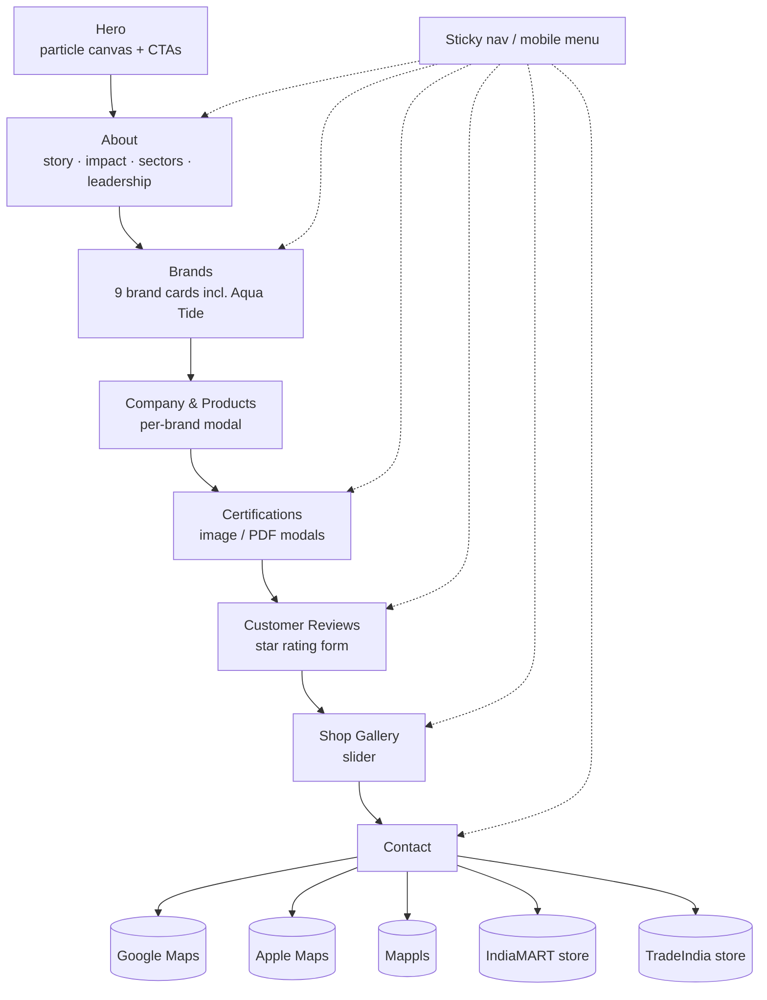

# 💧 Sri Anjaneya Enterprises | Business Website

> A responsive single-page website for **Sri Anjaneya Enterprises**, a submersible water motor and pump dealer in Secunderabad, Hyderabad. It presents the company, its dealer brands, its own brand **Aqua Tide**, dealership certificates, a shop gallery and contact and navigation links.


---

## ✨ Features

- **Hero section** with an animated particle canvas, tagline, GST number and calls to action.
- **Sticky navigation** that changes style on scroll, plus a slide-out **mobile menu**.
- **About** section: company story, reach and impact highlights, sectors served (corporates, retail, agriculture, pharmaceuticals, real estate, household) and the leadership team.
- **Brands section** with cards for KSB, Kirloskar, Wilo, Ekki-Deccan, C.R.I., Falcon, Lubi, Crompton and the in-house brand **Aqua Tide**, each showing its dealer status and typical uses.
- **Company & Products** picker that opens a modal per brand (Agriculture / Domestic categories; product listings are still being added).
- **Certifications** gallery: dealership and authorisation certificates (Kirloskar, EKKI, DECCAN, Wilo, KSB) and an IndiaMART TrustSeal, viewable in modals or as PDFs.
- **Customer review form** with a 5-star rating, required-field validation and live review cards. *Reviews are rendered in the browser only and are not stored yet.*
- **Shop gallery** slider with previous / next controls.
- **Contact** section with click-to-call and email links, the store address, one-tap directions on **Google Maps, Apple Maps and Mappls**, and links to the **IndiaMART** and **TradeIndia** storefronts.
- **Scroll-reveal animations** using `IntersectionObserver`.
- **Responsive breakpoints** at 960 px, 720 px and 700 px.

## 🛠 Tech Stack

| Area | Tools |
|---|---|
| Markup / styling | HTML5, CSS3 (custom properties, grid/flexbox, media queries) |
| Scripting | Vanilla JavaScript (Canvas 2D, `IntersectionObserver`, DOM modals) |
| Typography | Google Fonts: Playfair Display, Outfit |
| Assets | Brand logos, certificates (JPEG/PDF), shop and team photos |
| Dev tooling | VS Code Chrome debug config (`.vscode/launch.json`, `localhost:8080`) |

## 🏗 Site Map



## 📂 Project Structure

```
Sri-Anjaneya-Enterprises/
├── index.html            # The whole site: markup, inline CSS and JS
├── assets/
│   ├── certs/            # Dealership certificates (KSB, Wilo)
│   ├── owners/           # Leadership photos
│   ├── *.png / *.jpg     # Brand logos, product category images, icons
│   └── TrustSeal-IM.pdf  # IndiaMART TrustSeal certificate
├── Owners/               # Leadership photos used on the page
├── Shop images/          # Shop gallery photos
├── .vscode/launch.json   # Chrome debug config for localhost:8080
└── (root)                # Additional logo, certificate and image files
```

## 🚀 Run Locally

No dependencies or build step.

```bash
git clone https://github.com/Gonugunta-Venkata-Jayanth/Sri-Anjaneya-Enterprises.git
cd Sri-Anjaneya-Enterprises

# serve on port 8080 (matches .vscode/launch.json)
python -m http.server 8080
# open http://localhost:8080
```

You can also open `index.html` directly in a browser, or press **F5** in VS Code to launch Chrome against `localhost:8080` while the server is running.

## ☁️ Deploy

The site is fully static, so it can go on any static host (GitHub Pages, Netlify, Vercel). Publish the repository root with `index.html` as the entry page.

## 🔮 Future Work

- Fill in the per-brand **Agriculture / Domestic** product catalogues (currently "coming soon").
- Store customer reviews (for example Google Sheets, Firebase or Netlify Forms) so they persist and can be moderated; escape user input before rendering.
- Move the inline base64 images out of `index.html` into compressed files in `assets/` (WebP) to cut page weight.
- Remove duplicate or unused root-level images and saved `.mhtml` pages.
- Add SEO and Open Graph meta tags, a favicon, `LocalBusiness` structured data and an embedded map.
- Add a WhatsApp enquiry button and a quotation-request form.
- Update the footer copyright year.

## 👤 Author

Website built by **Jayanth Gonugunta Venkata**: [github.com/Gonugunta-Venkata-Jayanth](https://github.com/Gonugunta-Venkata-Jayanth)
